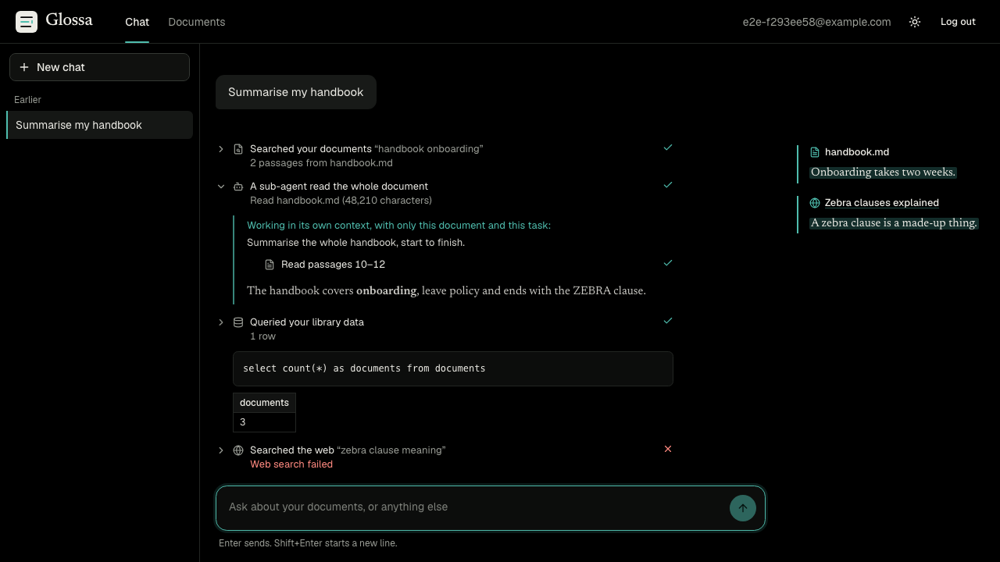
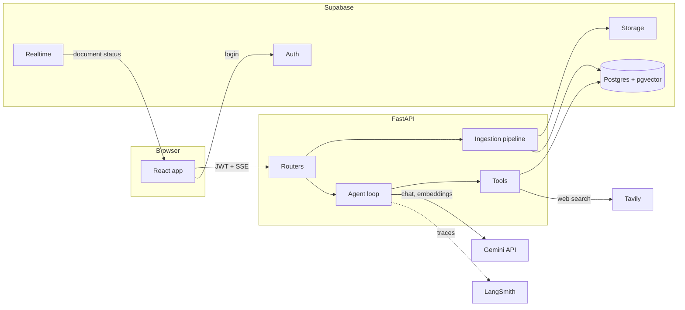
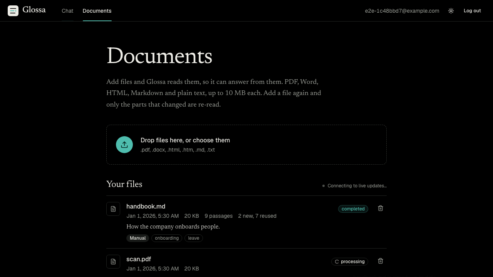

# Glossa

Ask questions about your own documents and read each answer next to the passages it
came from.

Glossa is a retrieval-augmented generation (RAG) app built from raw parts, with no LLM
framework: a FastAPI backend that calls the model SDK directly, Postgres with pgvector
for search, and a React frontend. It is the worked project for an agentic RAG course,
so the code is organised to be read: one concept per file.



## What it does

- **Chat with memory.** Threaded conversations, streamed token by token.
- **Answers from your files.** Upload PDF, Word, HTML, Markdown or text. Sources are
  shown beside the answer.
- **Hybrid search and reranking.** Keyword and vector search fused together, then
  re-ordered by a model, so exact codes and loose paraphrases both find their passage.
- **Incremental ingestion.** Uploading a file again re-processes only the chunks that
  changed. Identical files are skipped.
- **Metadata.** Each document gets a title, type, topics and summary, and search can
  filter on them.
- **More than search.** The agent can also query your library with SQL, read a whole
  document through a sub-agent, and fall back to the web.
- **Visible work.** Every tool call appears as a step above the answer, with a
  sub-agent's own steps nested under it.
- **Private by construction.** Row-Level Security on every table: a user can only
  reach their own threads, files, chunks and search results.

## Contents

- [Quick start](#quick-start)
- [How it works](#how-it-works)
- [Project layout](#project-layout)
- [Configuration](#configuration)
- [Database migrations](#database-migrations)
- [Tests](#tests)
- [Troubleshooting](#troubleshooting)
- [Course modules](#course-modules)

## Quick start

You need Python 3.14, Node 20+, a [Supabase](https://supabase.com) project and a
[Gemini API key](https://aistudio.google.com/apikey).

**1. Configure**

```bash
cp backend/.env.example backend/.env      # Supabase keys, SUPABASE_DB_URL, GEMINI_API_KEY
cp frontend/.env.example frontend/.env    # Supabase URL + anon key
```

In Supabase, the keys are under **Project Settings -> API keys**, and the database
connection string (`SUPABASE_DB_URL`) is under **Connect -> Session pooler**. For local
development you can turn off "Confirm email" under **Authentication -> Providers ->
Email** so that signing up logs you straight in.

**2. Install and create the database schema**

```bash
./start.sh --setup                                           # creates backend/venv, installs both apps, then starts them
backend/venv/bin/python backend/scripts/apply_migrations.py  # in another terminal, once
```

No connection string to hand? See [Database migrations](#database-migrations) for the
copy-and-paste route.

**3. Use it**

Open http://localhost:5173, sign up, add a file on the **Documents** page, and ask
about it in **Chat**.

After the first run, `./start.sh` starts both apps (backend on `:8000`, frontend on
`:5173`; Ctrl+C stops both). Override ports with
`BACKEND_PORT=8100 FRONTEND_PORT=5200 ./start.sh`.

<details>
<summary>Running the two apps by hand</summary>

```bash
cd backend
python3.14 -m venv venv
venv/bin/pip install -r requirements.txt
venv/bin/uvicorn app.main:app --reload --port 8000
```

```bash
cd frontend
npm install
npm run dev
```
</details>

## How it works



The backend talks to Supabase **as the signed-in user** (their JWT on every request),
so Row-Level Security applies to everything it reads and writes, including search.

### Ingestion



An upload is stored and answered immediately with status `pending`. A background task
then runs the pipeline, and each status change is pushed to the page by Supabase
Realtime (no polling).

| Step | File | What happens |
|------|------|--------------|
| Record manager | `services/record_manager.py` | A hash of the file decides: new, changed, unchanged, or a duplicate of another file. Unchanged and duplicate uploads stop here. |
| Parse | `services/parsing.py` | PDF, DOCX and HTML become Markdown via [docling](https://github.com/docling-project/docling), keeping headings and tables. Markdown and text are read as they are. |
| Chunk | `services/ingestion.py` | About 3,200 characters per chunk with 400 of overlap, split at headings, then paragraphs, then sentences. |
| Diff | `services/record_manager.py` | Each chunk is hashed and compared with what is stored. Only new chunks go on; stale ones are deleted. |
| Embed and store | `services/llm.py`, `db.py` | Gemini embeddings (1,024 dimensions) into `document_chunks`. |
| Metadata | `services/metadata.py` | One structured-output call fills `documents.metadata`: title, summary, type, topics, entities, date. |

### Answering

The model API is stateless, so every turn sends the last `CHAT_HISTORY_LIMIT` stored
messages. `services/agent.py` then runs the loop: stream the reply; if the model asked
for tools, run them, append the results, and go again.

| Tool | The model uses it for | How it works |
|------|-----------------------|--------------|
| `file_search` | What your documents say | `services/retrieval.py`. Postgres returns 20 candidates from a keyword search and a vector search fused with Reciprocal Rank Fusion; a model then scores each against the question and the best 5 are kept. Optional filters: document type, topic, filename. |
| `analyze_document` | Tasks that need a whole document: summaries, "list every...", reviews | `services/subagent.py`. A sub-agent gets a fresh context holding only the document and the task, has its own tools to search and page through it, and returns just its answer. The document never enters the main conversation. |
| `query_database` | Questions about the library as data: counts, dates, types | `services/tools/sql.py`. The model writes one `SELECT`. It is validated, then run by the `execute_readonly_sql` database function as the user, in a read-only transaction with a 5-second limit. |
| `web_search` | A fallback when the documents do not have the answer | `services/tools/web.py`. Tavily. Only offered when `TAVILY_API_KEY` is set. |

Adding a tool means writing one class (see `services/tools/base.py`) and listing it in
`services/tools/registry.py`.

### What the browser receives

`POST /threads/{id}/chat` responds with Server-Sent Events:

| Event | Meaning |
|-------|---------|
| `delta` | A piece of the answer |
| `tool_call` / `tool_result` | A step started / finished. `parent_id` is set for a sub-agent's steps |
| `subagent_delta` | A piece of a sub-agent's own text |
| `sources` | Passages or web pages to show beside the answer |
| `done` / `error` | The turn ended |

Steps and sources are saved with the message, so a reloaded conversation looks the same
as it did live.

## Project layout

```
backend/
  app/
    main.py              app, CORS, JSON error responses
    auth.py              Supabase JWT verification
    db.py                Repo: every database and Storage call, made as the user
    routers/             /threads, /documents, /me
    services/
      llm.py             the only file that calls the model API
      ingestion.py       chunking + the background pipeline
      parsing.py         file -> Markdown
      record_manager.py  content hashes, what to skip, what to re-embed
      metadata.py        structured metadata extraction
      retrieval.py       hybrid search + reranking
      agent.py           the tool-calling loop
      chat.py            one chat turn: prompt, memory, persistence
      subagent.py        the document sub-agent
      tools/             file_search, analyze_document, query_database, web_search
  scripts/apply_migrations.py
  tests/
frontend/
  src/pages/             Chat, Ingestion (Documents), Login
  src/components/chat/   MessageList, ToolSteps, SourceNote, ChatInput, ThreadSidebar
  src/lib/api.ts         typed API client and the SSE reader
  e2e/                   Playwright tests
supabase/migrations/     SQL, applied in order
.agent/plans/            the plan each module was built from
```

## Configuration

Everything is set through environment variables; there is no admin screen. The full
list with comments is in `backend/.env.example`.

| Variable | Default | What it changes |
|----------|---------|-----------------|
| `GEMINI_MODEL` | `gemini-flash-lite-latest` | Chat model. Must support tool calling. |
| `GEMINI_BASE_URL` | Gemini's OpenAI-compatible endpoint | Point it at any Chat Completions-compatible server (Ollama, LM Studio) to change provider. |
| `GEMINI_EMBEDDING_MODEL` | `gemini-embedding-001` | Embeddings, shortened to 1,024 dimensions to match the database. |
| `SEARCH_MODE` | `hybrid` | `hybrid`, `vector` or `keyword`. Switch to compare them on the same question. |
| `RERANK_ENABLED` | `true` | The model re-ordering step after search. |
| `RETRIEVAL_CANDIDATES` / `FILE_SEARCH_TOP_K` | `20` / `5` | Chunks fetched, and chunks kept. |
| `DOCUMENT_PARSER` | `docling` | `basic` uses small pure-Python parsers instead. |
| `METADATA_EXTRACTION_ENABLED` | `true` | The per-document metadata call. |
| `TAVILY_API_KEY` | empty | Set it to give the agent web search. |
| `CHAT_HISTORY_LIMIT` | `20` | Messages of memory sent each turn. |
| `LANGSMITH_TRACING` | `false` | Trace every turn, tool and sub-agent to LangSmith. |

**Cost of a request.** An upload makes one embedding call per batch of new chunks and
one metadata call. A `file_search` makes one embedding call and one rerank call. On a
free-tier key, set `RERANK_ENABLED=false` and `METADATA_EXTRACTION_ENABLED=false` to
stretch the daily quota.

**Changing the embedding model** means uploading your documents again: vectors from
different models cannot be compared.

## Database migrations

The schema lives in `supabase/migrations/` and must be applied in order. The backend
expects all of it: if a migration is missing, requests fail with a message telling you
to run them.

**With a connection string** (`SUPABASE_DB_URL` in `backend/.env`):

```bash
backend/venv/bin/python backend/scripts/apply_migrations.py            # apply what is pending
backend/venv/bin/python backend/scripts/apply_migrations.py --status   # list applied / pending
```

Applied files are recorded in `public.schema_migrations`. On a database where
`0001`-`0003` were run by hand before the script existed, the first run records those
as done and applies the rest.

**Without one**, print the SQL and paste it into the Supabase **SQL Editor**:

```bash
backend/venv/bin/python backend/scripts/apply_migrations.py --sql        # everything
backend/venv/bin/python backend/scripts/apply_migrations.py --sql 0004   # 0004 onwards
```

| Migration | Adds |
|-----------|------|
| `0001`-`0003` | Threads, messages, documents, chunks with pgvector, RLS policies |
| `0004` | Storage bucket and policies, async status, Realtime, similarity threshold; removes the unused managed-RAG tables |
| `0005` | Content hashes, one document per filename per user |
| `0006` | Document metadata and metadata filters in search |
| `0007` | Full-text column and the hybrid search function |
| `0008` | The read-only SQL function |
| `0009` | Full document text for the sub-agent |

## Tests

```bash
cd backend
venv/bin/pytest -m "not integration"   # unit tests: no network, the model is scripted
venv/bin/pytest -m integration -v      # against your Supabase project
```

The integration tests create two throwaway users and check that neither can reach the
other's rows, stored files, search results or SQL results, then delete them.

```bash
cd frontend
npx playwright install chromium            # once
npx playwright test e2e/agent-ui.spec.ts   # the interface, with the backend mocked: no model calls
npx playwright test e2e/auth.spec.ts       # sign-in flows
npx playwright test e2e/chat.spec.ts       # end to end against the live model
```

Lint and types: `ruff check . && ruff format --check .` and `npx pyright` from the
repository root, `npm run lint && npm run build` in `frontend/`.

## Troubleshooting

| Symptom | Cause and fix |
|---------|---------------|
| "The database is missing migrations" | The code is newer than the schema. See [Database migrations](#database-migrations). |
| "Failed to fetch" in the browser | The backend is not running, or `VITE_API_URL` / `CORS_ORIGINS` do not match the ports in use. |
| The first PDF takes minutes | docling downloads its layout models on first use, and loads them on the first PDF after each start. Later PDFs are fast. `DOCUMENT_PARSER=basic` skips it. |
| A document shows `failed` | The reason is on its row. Upload the same file again to retry. |
| Answers stop mid-day with a 429 | The free-tier daily quota for that model is used up. See "Cost of a request" above. |
| Status never changes without a reload | Realtime is not reaching the page; the label above the list says so. The page falls back to polling. Check that migration `0004` is applied. |
| No web search | `TAVILY_API_KEY` is not set, so the tool is not offered to the model. |

## Course modules

`PRD.md` describes the eight modules and `PROGRESS.md` tracks them.

| Module | Topic | Where to read |
|--------|-------|---------------|
| 1 | App shell, auth, streaming chat, tracing | `auth.py`, `routers/threads.py`, `services/llm.py` |
| 2 | Your own retrieval and memory | `services/ingestion.py`, `services/chat.py`, migration `0004` |
| 3 | Record manager | `services/record_manager.py`, migration `0005` |
| 4 | Metadata extraction | `services/metadata.py`, `schemas.py`, migration `0006` |
| 5 | Multi-format support | `services/parsing.py` |
| 6 | Hybrid search and reranking | `services/retrieval.py`, migration `0007` |
| 7 | Additional tools | `services/tools/`, `services/agent.py`, migration `0008` |
| 8 | Sub-agents | `services/subagent.py`, `components/chat/ToolSteps.tsx`, migration `0009` |

Built with React, Vite, Tailwind and shadcn/ui; Python and FastAPI; Supabase (Postgres,
pgvector, Auth, Storage, Realtime); the Gemini API through its OpenAI-compatible
endpoint; and LangSmith.
